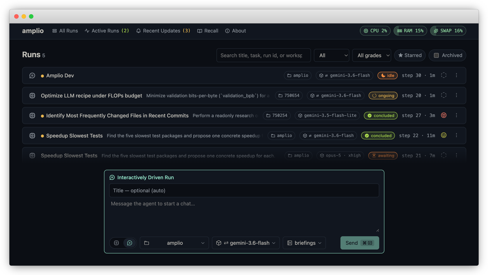
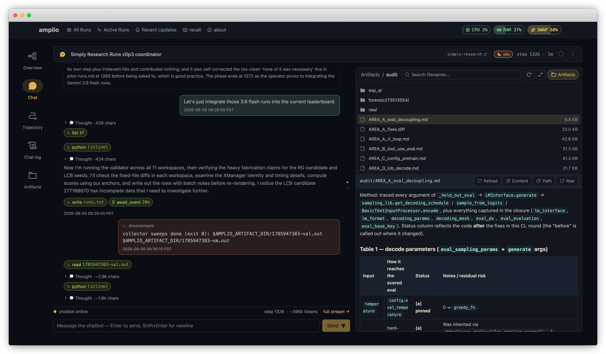

# Runs

A **run** is one unit of work with its own task, workspace, model and history.
Inside it, an **agent session** is one conversation with the model: the run's
root session, plus a session for every sub-agent it spawns.

A run is a soft isolation of a work: agent sessions can coordinate with each
other within a run: communication via messaging, coordination via shared artifact
dir, and collaboration via linked VCS (isolated edits but shared commit log), etc.

The front page of Amplio web UI show a list of existing runs. The runs list 
can be filtered according to status (Active / Updates / etc.), grades (human
or auto-critic assigned), star / archive, etc. or searched. A new run can be
started by interacting with the prompt field at the bottom, which will expand
to the "New Run" form upon focus.

## Interactive run and autonomous run

Amplio support two modes of runs:

**Interactive.** The most typical mode used by common agentic coding harnesses: 
you interact with a chatbot agent that can make tool calls. You drive the work
through the interaction with the chatbot.

**Autonomous.** You give a task; a `main-agent` works until it is finished. An auto-critic will review the run and generate a report. You review the results and report, send follow up requests to start a new iteration if needed.

The different modes impact the behaviors of some internal mechanism (e.g. how and
when the run level auto-critic is triggered), but they are not completely separated.
Under the hood: for autonomous runs, one can still activate the chatbot, which can
bridge the user and the autonomous agent to check the progress, analyze the trajectory,
or steer the run mid-execution; on the other hand, in an interactive run,
the chatbot can spawn sub-agents to autonomously work on long horizon tasks.

## What you see while it runs

There are several views of a run: 

- **Overview** shows the overall meta information of the run, the model, workspace,
  the task, the auto-critic report, the sub-agent session tree, etc.
- **Chat** is the UI for interacting with the chatbot. The **+** in the text
  box's toolbar offers **Repeat**, which turns the message into a
  [loop](#loops); its form opens above the box (a sheet on a phone). The chosen
  option shows as a chip beside the + ("Repeat every 30m · until Nov 17");
  click it to edit, or its × to remove it. Typing `/loop` as the first word of
  a message opens the form and removes the word; nothing else in the message is
  read. The chatbot never concludes, so the chat doesn't offer verification
  (`/verify` says so, above the box, where the forms open).
  While the chatbot has loops, the status line above the box shows them ("1
  loop · next 15:30"), a link to them in the Inspector. The Overview's
  follow-up box, which messages the main agent, offers both **Verify the
  result** and **Repeat**, and the same shortcuts (`/verify`, `/loop`).
  Together they make a loop that [verifies each tick](#verifying-each-tick)
  (the chip reads "Verify each tick"). The New Run form takes the same
  shortcuts as the first word of its task.
- **Trajectory** and **Chat log** are viewer of the execution trajectories of all
  the agent sessions of this run. They are different display of the same data.
- **Artifacts** is a viewer of the artifacts (plan, todo, reports, etc.) generated
  by the agents for this run (a mini artifacts viewer can be open in the sidebar of
  the **Chat** page as well).
- **Inspector** shows, for one session or the whole run, its
  [verification](#verified-conclusions) (state, the verifier and round, criteria,
  model and history), its [loops](#loops) (summary, prompt, next tick, ticks so
  far, and whether each tick is verified) and the processes its bash calls left running. With the token you can turn
  verification on, change or clear it, and add, edit or stop loops, without
  sending a message; the readonly view shows the same without the controls.
  Process command lines can carry secrets, so only the owner sees them. (It
  replaces the Processes tab; its old address leads here.)

Wherever sessions are listed (the Overview's session tree, the session picker of
the Trajectory and Chat log, the Inspector's, the Chat page's sub-agent sidebar),
a session whose verification is in force shows a seal and one with loops a repeat
icon, each a link to that section of the Inspector (the Inspector's phone picker
marks them ◆ and ↻). The sidebar lists running sub-agents, and keeps one with
loops listed while it is idle between ticks. Above the
Overview's follow-up box, a status line shows the main agent's verification (in
force, or how it ended: "passed · round 1/3") and its loops.

Amplio uses background observers to summarize and break the agent trajectories into
phases, making it easier for operators to review the trajectories, and for the
auto-critic agent to grade the run.

## Sessions, sub-agents and status

A session is `ongoing` while working, `awaiting` while blocked on something,
`idle` when parked for input, and ends `concluded`, `crashed` or `cancelled`.
An autonomous agent finishes by calling its `conclude` tool with its result
(a reply without tool calls counts as one too, unless `[agent]
require_conclude` is on: then a reply gets a note asking for `conclude`, and
the fifth in a row fails the session); that result is what its parent, or you,
receive. An interactive chatbot has no such tool: it never concludes.

An agent can spawn sub-agents for focused work — a survey, a build, a review —
each with its own session, its own context, and its own history in the same run.
A sub-agent's result comes back to its parent as a message; the parent decides
what to do with it.

If the server stops while a run is working, the run resumes on the next start:
amplio revives the sessions that were still active. A crashed run can also be
revived on demand from the UI or with `amplio client restart`.

Amplio is designed to be robust to resume from crashes that can occur any time during execution while keeping the agent session tree consistent. Amplio does not make proactive decision on two questions:

- Whether to auto re-run failed tool call: Amplio report failures / crashes to the agent and let the agent decide the best next step.
- Whether to auto resume crashed run: Amplio leave the decision to the user whether or when to resume, depending on the crash reasons.

## Verified conclusions

For a result that must be right, an autonomous agent's conclusion can be
checked by an independent **verifier** before it is delivered. The verifier is
a sub-agent of the agent, started by amplio, of its own agent type
(`verifier`): the standard tools in the agent's workspace, and a prompt for the
role. It reads the agent's trajectory, inspects the files and runs whatever it
needs (tests, builds), without changing the workspace, then gives its verdict
with `conclude(verdict: "PASS" | "FAIL", findings)`. A reply without tool calls
isn't a verdict: it is asked to call `conclude`, and after two such replies in a
row its next one concludes it as a FAIL ("verifier gave no verdict"), whatever
it says. Each check costs a full agent, so verification is never on by default.

Who can turn it on: you, for any autonomous session, with the verification
form (on the New Run form for the root agent, attached to a follow-up message,
which the Overview's follow-up box offers, or in the run's Inspector for any
session), `amplio client verify`,
the API, or `amplio headless run --verify` (the root agent); and a parent agent,
for its own sub-agents, with `spawn_agent(verify: {...})` or
`send_message(verify: {...})`; and a loop that [verifies each
tick](#verifying-each-tick), for each tick. A request has three optional fields (the form
fills in the server's defaults):

| field | default |
|---|---|
| criteria | none: the verifier checks the conclusion against the agent's current request (its task, or the latest message that re-engaged it) |
| model | `[verify] model` in the config file, else the agent's own model; a different model family checks more independently |
| max rounds | `[verify] max_rounds` (3); `0` = unbounded |

**Versions.** Every request starts a new **version** of the verification: v1,
v2, and so on, counted from the session's stream. Turning verification on
again, or changing it while it is on (a new request replaces the one in
force), each starts one. Each candidate is labelled with its version and its
number in it ("v2, candidate 1"), in the messages to the agent and to its
verifier, in `GET .../verify` (`version`, `candidate`, and each history entry's)
and in the Inspector's history.

The agent is told that its conclusion will be checked, and against what. When
it calls `conclude(result)`, the result goes to the verifier as its candidate,
and the call waits for the verdict (`awaiting`, with no timeout). A pass
concludes the agent with exactly that result. A rejection returns the
verifier's findings; the agent fixes what it can and concludes again, and the
same verifier gets the new candidate. Anything else that arrives meanwhile (a
message, a notification) ends the wait early so the agent can deal with it;
`conclude()` without a result then waits again. A verdict that reaches the
agent while it isn't waiting (it went back to work, or is in `await_event`)
wakes it and arrives as a message saying where it stands (the findings and the
round, for a rejection): after a pass, `conclude()` delivers the verified
result, and a new result goes back to the verifier. Either way the agent reads
the verdict as amplio tells it, not as a sub-agent's result: the verifier's own
output stays in its session, and the chat shows each verdict as a badge with
its findings. A reply without tool calls is never a new candidate while one is
with the verifier: amplio asks for `conclude` instead, and after two such
replies it waits for the verdict on the pending candidate, as `conclude()`
would. (With nothing pending, a reply is the candidate, and amplio waits for its
verdict.) Its parent's `child_result`
says how it ended: `verified by quick-rabbit (round 2)`, or, when the rounds
run out (the agent then concludes with its latest candidate), `not verified:
after 3 rejections` with the latest findings.

The rules, briefly:
- a verdict counts for the candidate the verifier received last before it concluded, and only while that candidate's version is current; a round is one rejection of the latest candidate (a rejection of a candidate the agent has already replaced is no round, but the agent is told its findings);
- a message (or a change of verification sent with it) that reaches the agent while it writes its `conclude` call comes first: that call returns without giving anything to the verifier, which checks the answer written after the message;
- concluding again with the same result while the verifier works doesn't message it again;
- a verifier that crashes or is cancelled isn't a round: the agent is told (with why), and `conclude()` re-engages it; three such stops in a row, or a verifier that can't be started, end the verification (not verified);
- a new version withdraws the candidate the verifier has: it is never delivered, the agent's waiting `conclude` call returns "superseded by v3; your conclusion for v2 was withdrawn", and the trajectory and the Inspector mark it withdrawn. The verifier isn't cancelled: it is told "v2 is withdrawn; stop and wait for the next candidate", ends its turn without a verdict, and the same verifier checks the agent's next conclusion, with the new request and criteria and what it has learned so far. A new verifier is started (the old one cancelled) only by a version that asks for another verifier model, or after a version that ended because the verifier stopped too often or couldn't start: set verification again, or change its model, to get a fresh one;
- a verdict that comes after its version was superseded (or turned off) is recorded as stale and changes nothing: it is no round and no pass, and the agent is told it doesn't count;
- turning verification off withdraws the candidate the same way and ends the agent's wait; its next conclusion is delivered as it is. The verifier is kept, idle, for a later version (it is cancelled with the agent's other sub-agents when the agent concludes);
- if amplio restarts while the agent waits, the wait resumes, or settles a verdict that came meanwhile; a new version that came meanwhile withdraws the conclusion the call waited for; if you cancel the agent while it waits, a later message revives it with its conclusion withdrawn;
- only a session's parent (or you) can change its verification through the tools; an agent can't cancel or message its own verifier, nor can its other sub-agents, nor start one with `spawn_agent`, and a verifier is never verified. This binds the tools, not an agent's shell: an agent that runs `amplio client` acts as you, as with everything else in the API;
- once the agent has been told its verification ended without a pass, its next conclusion is delivered not verified, even if the verifier passes it on a later look;
- interactive agents never conclude, so they are never verified.

The state and its history are in the session's stream, including each of the
verifier's verdicts: `GET /api/runs/<run>/sessions/<session>/verify` reads
them. A verifier started before the `verifier` type existed is a standard
agent, and keeps working: re-engaged, it is asked for the first-line form.

## Loops

A **loop** re-sends a prompt to a session on a schedule: "check the eval and
report changes", every 30 minutes, for 7 days. Each **tick** arrives as your
message, prefixed with the loop and its tick number:

    [loop 1 · every 30m until 2026-11-17T15:30:00-08:00 · tick 4] check the eval and report changes

Because a tick is operator input rather than a notification, it wakes the
session whatever it is doing: a busy agent sees it at its next step, and an
idle, waiting or concluded one starts a new turn. An agent can already wake
itself with `sleep N; amplio-notify`, but only while it is still running; a
loop is yours, shows up in the trajectory, and can bring a finished agent back.

Setting, changing or stopping a loop doesn't interrupt the agent, and it isn't
told: it learns of a loop from its ticks, labelled as above, and only ticks
wake it. Set a loop with the
loop form: on the New Run form, it repeats a prompt to the root agent (the task
unless you write another), first one interval after the run starts; as
**Repeat** on a message in the Chat or the Overview's follow-up box, the
message is the loop's prompt, so with send now on, its first tick is the
message itself (it isn't also sent as a plain message). The Inspector lists a
session's loops (with the ticks left, for one that ends after N) and adds,
edits and stops them; an edit takes effect from the next tick, one new
interval after the last one sent (or at once if that has passed), and its
"after N more ticks" counts from when you opened it, even if the loop ticks
while you edit. Set, list and stop loops with [`amplio client loop`](cli.md#loop) too. The chat labels each tick
with its loop and number. A loop can't be set on a verifier or a session under
one (its ticks would revive the verifier), and a session can have at most 20
loops. A loop has:

| field | default |
|---|---|
| interval | required; at least one minute |
| prompt | required |
| send now | on: the first tick goes at once and counts as tick 1; off waits one interval |
| ends | after `[loop] expiry` from the [config](configuration.md) (7 days; the form shows the date it comes to, in the server's time zone); or after N ticks; or never |

The schedule is stored as an iCalendar recurrence rule (`DTSTART` plus `RRULE`,
the format calendar apps use), so the API also accepts rules the CLI flags
don't produce, such as "Mondays, Wednesdays and Fridays at 9:00". Rules with
times of day are read in the server's time zone, the same clock agents see in
their timestamps; a plain interval is elapsed time.

Whatever the rule says:

- ticks are **at least a minute apart** by their scheduled times (one sent late
  can leave a few seconds less before the next, which stays on schedule);
- ticks that fall while the server is down are **not replayed**, and count
  toward an "after N ticks" end, as a missed meeting does in a calendar;
- a loop **ends** as its schedule says, when you stop it, when its session or
  one above it is **cancelled** (by you, by a parent agent, or because you
  cancelled the run), or when its run is archived or deleted. Cancelling is a
  deliberate stop, so a tick never undoes it. A crash doesn't end a loop: the
  next tick revives the session, as a message from you would, and a session
  that crashes again once revived (say, while its model is down) keeps its
  loop. But a tick that couldn't revive its session at all (its agent type or
  workspace is gone; the server log says why) ends the loop at the next tick,
  rather than leaving an unread tick every interval.
- a loop that never ends really doesn't: as it ticks, its schedule's `DTSTART`
  moves up to a recent tick's time, on the same grid, so the list of loops may
  show a later `DTSTART` than the one you set.

Loops fire only under `amplio serve`. A loop set on a run doesn't fire while the
run is driven by `amplio headless resume`; a harness that wants periodic
prompts there sends them with `amplio notify`.

### Verifying each tick

A loop on an autonomous agent can carry a [verification](#verified-conclusions)
request (criteria, model, max rounds, as for any verification; the server's
defaults are filled in when the loop is set). Each tick is a new task (the same
words, a different world: "run the integration tests", "classify my emails"),
so each tick starts a new version of the session's verification, written
together with the tick's message: a verifier checks the agent's conclusion to
that tick before it is delivered. The version is set by the loop on your behalf
(the history says "turned on by loop 2"), and the tick names it in its label,
which the agent reads and the chat shows:

    [loop 1 · every 1h, 2 times · tick 3 · verification v3] run the integration tests

Criteria left blank mean the tick's prompt, and the label is all the agent is
told. Criteria you gave add one line just before the tick: "[system]
Verification v3 checks your conclusion against: the tests pass." Each tick can
cost up to max-rounds verifier runs. The same verifier checks every tick (it
keeps what it learned), unless a tick asks for another model.

A session has **one verification at a time**, and the latest request wins:
- each tick's version replaces the one in force, whoever set it: yours, a parent
  agent's, or the task's own verification from the New Run form, if the task
  hasn't concluded by the loop's first tick;
- a tick that comes while the previous tick's conclusion is still with the
  verifier withdraws it, as any new version does, so give the interval room for
  a verification;
- only one of a session's loops can verify its ticks: a second is refused until
  the first stops verifying (or stops).

Turn it on with **Verify each tick** in the loop form (on the New Run form, and
in the Inspector, also for a loop whose rule the form doesn't write), by
choosing both **Verify the result** and **Repeat** on a follow-up message, with
`amplio client loop add --verify` or `loop edit --verify`, or with `verify` on
the loops API. A change applies from the next tick. When a loop stops verifying
its ticks, its next tick also turns off the version the loop started, if it is
still in force, so that tick isn't checked against what the loop used to ask;
a version someone else set since is left alone. It is offered only where the
session concludes: interactive agents and verifiers can't have it.

## Artifacts

Every run gets a directory of its own, created with the run, exported to the
agent as `$AMPLIO_ARTIFACT_DIR`. It is the right place for anything the agent
produces that is not source code: a generated report, a plot, a scratch script,
intermediate data.

The **Artifacts** view browses that directory and previews what it finds:
markdown (rendered, with relative links and images resolved against the artifact
dir), source and text files (syntax-highlighted), images, and PDFs — shown in
the browser's own PDF viewer, so paging, zoom, find and print all work. Anything
else downloads. A link to a PDF may name a page (`[fig 3](paper.pdf#page=7)`),
and the viewer opens there.

## Reports

When an autonomous run's main agent concludes, a **report** is generated by a
critic — a separate agent, using the HQ system model, that reads the run's
history and writes an assessment. It contains:

| field | what it holds |
|---|---|
| summary | what the iteration did, in prose |
| grade | the critic's verdict (see below) |
| key achievements | claims, each cited to the steps that support them |
| failure modes | what went wrong, likewise cited |
| struggles | places the agent got stuck, and for how long |
| artifacts | files, commands, metrics and identifiers worth checking |
| phases | the run's arc, from the phase summaries |

Reports are **per iteration**: after reading the report, the operator can
send follow up to prompt the agent to push the work further. Each time a
new iteration concludes, a new report will be generated.

Interactive runs get no automatic report — there is no conclusion to trigger it
— but you can manually trigger the generation from the run page.

### Grades

The critic grades each iteration on a five-point scale:

    garbage · bad · meh · good · excellent

You can override it. A human grade takes precedence over the critic's and is
what the run list shows.

## Ending a run

`cancel` stops a run and cascades to every session under it, and ends the
run's [loops](#loops). Cancellation is a
request: it returns once accepted, not once every agent has stopped.

Archiving takes a run out of your default list without deleting anything, which
is the reversible way to keep the dashboard readable. It also ends the run's
[loops](#loops); unarchiving doesn't restart them. Deleting removes the run's
database rows and its artifact and blob directories, and cannot be undone;
lessons mined from it survive, because they are corpus rather than run data.
